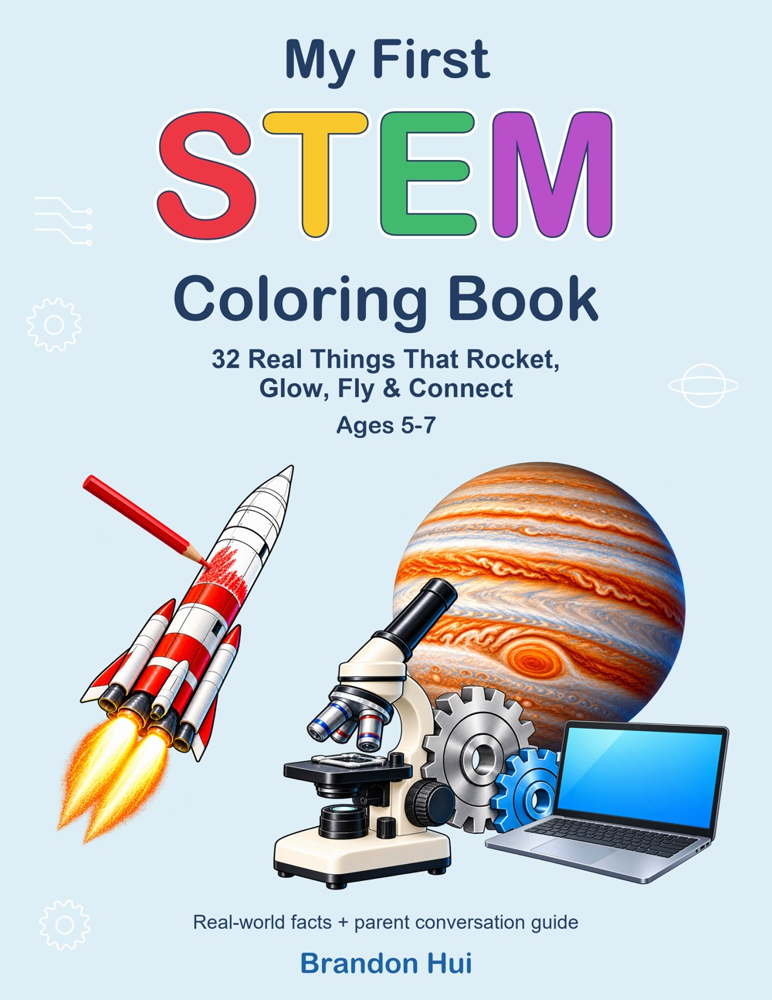

# My First STEM Coloring Book

**[Available on Amazon](https://www.amazon.com/dp/B0HNP4YY3Q)** · [Preview four topics](My-First-STEM-Coloring-Book-Sample.pdf)

A coloring and learning book for ages 5–7 by **Brandon Hui**.

Explore 32 real things from Science, Technology, Engineering, and Math through large coloring pictures and short facts. A grown-up can read along, ask questions, and help children connect each topic to everyday life.

**32 Real Things That Rocket, Glow, Fly & Connect for Ages 5–7**

[Preview four topics](My-First-STEM-Coloring-Book-Sample.pdf)

## Try the sample

The five-page PDF includes a sample introduction and four selected topic pages:

| Subject | Topic | Original book page |
| --- | --- | --- |
| Science | Planets | 7 |
| Technology | Light Bulb | 27 |
| Engineering | Airplane | 57 |
| Mathematics | Patterns | 75 |

Original page numbers are retained. For single-sided coloring, print each topic on a separate sheet. This is a preview, not the complete book.

## About the complete book

- 32 STEM topics with short, accessible facts.
- Four subject introductions and a My STEM Words checklist.
- My Favorite STEM Thing and Invent Something drawing activities.
- A parent and teacher conversation guide with two questions for every topic.
- 86 US Letter pages, including blank backs for the main coloring and activity pages.

## About this project

I created this book to bring practical STEM ideas into a coloring and reading activity for young children. The project combines topic selection, short educational explanations, page layout, and artwork review.

Illustrations were created with AI tools and edited by the author. This repository shares the cover and selected interior pages; editable manuscripts and production files are not included.

## About the author

Brandon Hui creates AI tools, prompt specifications, and children's books, with interests in technology, learning, and visual communication.

[GitHub profile](https://github.com/culturelight) · [LinkedIn](https://www.linkedin.com/in/brandon-hui-b321548a/)

## Copyright and sample use

Text, concept and layout copyright © 2026 Brandon Hui. All rights reserved. This is a book preview repository; no open-source license is granted. Please share the repository link rather than redistributing the files. See [COPYRIGHT.md](COPYRIGHT.md).
